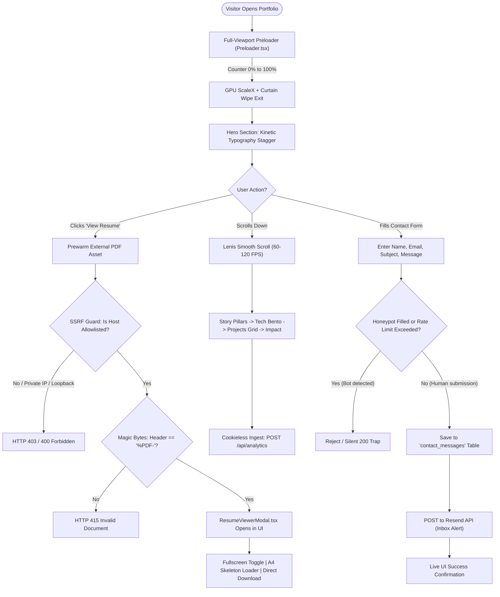
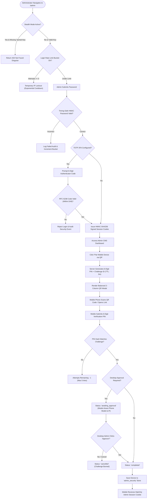

```mermaid
flowchart TD
    subgraph External["External Entities & Services"]
        Visitor["Public Visitor / Recruiter"]
        Lou["Administrator (Lou Diamond)"]
        Resend["Resend Email Service"]
        Supabase["Supabase Cloud (PostgreSQL + S3 Storage)"]
        GitHub["GitHub REST API"]
        RemotePDF["External Resume Host (Google Drive / CDNs)"]
    end

    subgraph System["Portfolio Platform Boundary"]
        App["0.0 Lou Diamond Portfolio & CMS Platform"]
    end

    Visitor -->|"Browse Pages & View Projects"| App
    Visitor -->|"Submit In-Site Contact Form"| App
    Visitor -->|"Stream First-Party Cookieless Telemetry"| App
    Visitor -->|"Request Resume PDF Preview"| App
    App -->|"Deliver Cinematic Kinetic UI (60-120 FPS)"| Visitor
    App -->|"Stream Secure In-App PDF Modal"| Visitor
    App -->|"Return Message Submission Status"| Visitor

    Lou -->|"Sign In (Stealth Key + Password + TOTP 2FA)"| App
    Lou -->|"Initiate Mobile QR Pairing"| App
    Lou -->|"Manage Content (Hero, Projects, Bento, Story)"| App
    Lou -->|"Send Outgoing Email Replies to Leads"| App
    Lou -->|"Trigger Snapshots & Database Sync"| App
    App -->|"Render Admin CMS Dashboard & Analytics"| Lou
    App -->|"Display QR Code & Verification Status"| Lou

    App -->|"Dispatch Contact Alerts & Lead Replies"| Resend
    Resend -->|"Delivery Receipts & Event Webhooks"| App

    App -->|"Execute SQL Queries (Content, Messages, Telemetry)"| Supabase
    App -->|"Store / Retrieve Uploaded Media Assets"| Supabase
    Supabase -->|"Query Results & Asset URLs"| App

    App -->|"Fetch Public Repos, Commits & Star Stats"| GitHub
    GitHub -->|"Raw Repository Metrics"| App

    App -->|"Fetch External PDF Stream (SSRF Guarded)"| RemotePDF
    RemotePDF -->|"Binary PDF Content (%PDF-)"| App
```

```mermaid
flowchart TB
    subgraph ExternalEntities["External Actors & Third-Party APIs"]
        Visitor["Public Visitor"]
        Admin["Administrator (Lou)"]
        ResendAPI["Resend Email API"]
        GitHubAPI["GitHub API"]
        RemotePDFHost["Remote Resume Host"]
    end

    subgraph Processes["Platform Sub-Processes"]
        P1["1.0 Content Delivery & ISR Caching"]
        P2["2.0 Cookieless Telemetry Engine"]
        P3["3.0 SSRF-Guarded Resume Streamer"]
        P4["4.0 Contact Ingest & Honeypot Filter"]
        P5["5.0 Multi-Factor Auth & QR Device Pairing"]
        P6["6.0 Content & Systems CMS Manager"]
        P7["7.0 Outbox Email Reply Engine"]
    end

    subgraph DataStores["Data Stores (Local JSON / Supabase PostgreSQL)"]
        D1[("D1: Portfolio Content Store\n(portfolio_store / JSON)")]
        D2[("D2: Analytics Events Store\n(analytics_events)")]
        D3[("D3: Contact Messages Inbox\n(contact_messages)")]
        D4[("D4: Admin Security & Devices\n(admin_security)")]
        D5[("D5: Snapshot Vault\n(portfolio_snapshots)")]
        D6[("D6: Media & Assets Storage\n(Supabase Bucket)")]
    end

    Visitor -->|"Page & Asset Requests"| P1
    D1 -->|"Profile, Projects, Skills Data"| P1
    P1 -->|"Hydrated Kinetic UI (HTML/JS)"| Visitor

    Visitor -->|"Scroll Depth, Clicks & Goals"| P2
    P2 -->|"Sanitized Telemetry Record"| D2

    Visitor -->|"Open Resume Viewer"| P3
    P3 -->|"Fetch Document"| RemotePDFHost
    RemotePDFHost -->|"Binary Stream"| P3
    P3 -->|"Validated Same-Origin PDF Stream"| Visitor

    Visitor -->|"Form Data (Name, Email, Message, Bot)"| P4
    P4 -->|"Valid Inquiries (Filtered Spam)"| D3
    P4 -->|"Real-Time Lead Alert Dispatch"| ResendAPI

    Admin -->|"Credentials + TOTP Code + Mobile PIN"| P5
    P5 <-->|"Validate Fingerprints, Tokens & Epoch"| D4
    P5 -->|"Signed Session Cookie"| Admin

    Admin -->|"CRUD Edits, Image Uploads, Snapshots"| P6
    P6 <-->|"Write / Read Content Records"| D1
    P6 -->|"Store Uploaded Mockup/Avatar"| D6
    P6 -->|"Safety Backup Checkpoint"| D5

    Admin -->|"Compose In-App Reply"| P7
    D3 -->|"Lead Email & Message Context"| P7
    P7 -->|"Send Reply via Resend"| ResendAPI
    P7 -->|"Update Thread Status"| D3
```

# SYSTEM DOCUMENTATION — CINEMATIC FULL-STACK & BUSINESS ANALYTICS PORTFOLIO CMS

**Owner:** Lou Diamond Lava Valdellon (Class of 2026, BSIT)  
**Title:** Full-Stack Developer & Business Analytics Specialist  
**Target Platform:** Vercel (Hobby Tier — $0/month)  
**Database & Media Storage:** Supabase (PostgreSQL 15 & Storage Buckets) + Local JSON Fallback  
**Version:** 2.0.0 (Production Ready)  
**Last Updated:** November 2026  

---

## 1. System Overview & Core Mission

This system is an enterprise-grade, high-performance personal web platform engineered to demonstrate 100% full-stack ownership across Database, Backend, and Frontend architectures. It merges a **cinematic, kinetic public portfolio** with a **private, feature-rich Content Management System (CMS)**, a **cookieless real-time business analytics engine**, a **multi-layered cryptographic security perimeter**, and an **in-app media viewing suite**.

### Core Engineering Principles
1. **Zero Monoliths:** Every feature, section, modal, and input field is isolated into strict, modular component partials.
2. **Zero-Lag Performance:** 60–120 FPS smooth scrolling and interactions using GPU-composite transforms only (`translate3d`, `scale`, `opacity`), achieving a 95+ Google Lighthouse score.
3. **Data Isolation:** Zero hardcoded content in JSX markup; all public copy, project data, and skills hydrate from type-safe data stores with instant CMS reactivity.
4. **Resilient Hybrid Persistence:** The system operates seamlessly in offline local development via atomic JSON files (`/data/portfolio-db.json`) and transitions transparently to Supabase PostgreSQL in production without code changes.
5. **Zero Hosting Cost:** Architected specifically for Vercel's Hobby Tier ($0/month) and Supabase Free Tier ($0/month) with zero runtime dependencies on paid services.

---

## 2. Full Technology Stack & Tools Inventory

### Core Framework & Runtime
| Tool / Library | Version | Role in Architecture |
| :--- | :--- | :--- |
| **Next.js** | `16.4.6` | App Router, Server Components, Route Handlers, Incremental Static Regeneration (ISR), Webpack/Turbopack builds. |
| **React** | `19.3.0` | Modern React UI runtime with concurrent features, Hooks, Suspense boundaries, and Server Actions. |
| **TypeScript** | `^5.0` | Strict end-to-end type safety across schemas, API payloads, component props, and database records. |

### Styling & Design System
| Tool / Library | Version | Role in Architecture |
| :--- | :--- | :--- |
| **Tailwind CSS** | `^4.0.0` | Modern CSS engine utilizing `@theme` directives, fluid `rem`/`vw` scaling, and custom design tokens. |
| **PostCSS** | `^8.5.3` | CSS transformation and autoprefixing pipeline. |
| **clsx & tailwind-merge**| `^2.1.1` / `^3.0.2` | Conditional CSS class merging preventing class collisions across modular UI components. |

### Kinetic Animation & Smooth Scrolling
| Tool / Library | Version | Role in Architecture |
| :--- | :--- | :--- |
| **GSAP (GreenSock)** | `^3.12.7` | ScrollTrigger viewport reveals, SplitText character staggers, timeline sequencing, and liquid image distortions. |
| **Lenis** | `^1.1.20` | Virtual smooth scrolling thread synchronized directly with GSAP's requestAnimationFrame (RAF) ticker. |

### State Management & Data Fetching
| Tool / Library | Version | Role in Architecture |
| :--- | :--- | :--- |
| **TanStack React Query** | `^5.107.1` | Asynchronous server-state synchronization, optimistic UI mutations, automatic caching, and multi-tab sync. |
| **PortfolioContext** | Custom | React Context driving client-side telemetry ingestion, global modal triggers, and optimistic UI updates. |

### Validation, Security & Cryptography
| Tool / Library | Version | Role in Architecture |
| :--- | :--- | :--- |
| **Zod** | `^3.24.2` | Runtime schema validation for contact messages, admin credentials, portfolio data, uploads, and device pairings. |
| **Web Crypto & Node Crypto** | Built-in | Constant-time HMAC-SHA256 signature verification, AES-256-GCM encryption for TOTP secrets, and secure random token generation. |
| **qrcode** | `^1.5.4` | Server-side and client-side vector SVG generation for mobile cross-device pairing and TOTP authenticator setup. |

### Cloud Services & APIs
| Service | Integration | Purpose |
| :--- | :--- | :--- |
| **Supabase** | PostgreSQL 15 | Relational persistence for portfolio content, contact inbox, analytics events, device store, and snapshot vault. |
| **Supabase Storage**| S3 Compatible | Cloud bucket (`myPortfolio`) storing uploaded avatars, project screenshots, and PDF resume assets. |
| **Resend** | REST API | Transactional email dispatch for public contact form notifications and in-app administrative email replies. |
| **GitHub REST API** | `/api/github` | Real-time code activity, star count, and repository proof bar cached with Next.js ISR. |

### Testing & Quality Assurance
| Tool / Library | Version | Purpose |
| :--- | :--- | :--- |
| **Vitest** | `^5.1.0` | High-speed unit and integration testing suite for auth, crypto, security challenges, and input sanitizers. |
| **Playwright** | `^1.65.1` | Cross-browser End-to-End (E2E) testing for public navigation, contact submissions, stealth gate, and admin CMS flows. |
| **ESLint** | `^9.0.0` | Code hygiene and strict linting enforcement. |

---

## 3. High-Level Architecture & Diagrams

> [!NOTE]
> **How Markdown Renders Diagrams:**
> Markdown (`.md`) files store diagrams as text specifications (such as Mermaid code blocks or ASCII Box Art).
> - **In Plain Text / Code Editors:** Markdown displays the raw text code.
> - **In VS Code / IDE Preview:** To see the graphical SVG charts directly inside VS Code, install the free extension **"Markdown Preview Mermaid Support"** (by Matt Bierner), then press `Ctrl + Shift + V` (or `Cmd + Shift + V`).
> - **On GitHub:** When committed and pushed to GitHub, GitHub automatically transforms the ````mermaid` blocks into visual vector charts.
> - **Zero-Plugin ASCII Diagrams:** Below each Mermaid diagram, an instant **Visual ASCII Box-Drawing Chart** is also included so you can inspect the full diagram immediately in any standard text editor without needing any extensions.

---

### 3.1. System Context Diagram (Level 0 DFD)
The System Context Diagram establishes the global boundary of the portfolio and CMS platform, depicting all external actors, services, data inputs, and system outputs.

#### Visual Box Diagram (Instant View)
```text
┌─────────────────────────────────────────────────────────────────────────────┐
│                       EXTERNAL ACTORS & SERVICES                            │
│                                                                             │
│  ┌───────────────────────┐                    ┌──────────────────────────┐  │
│  │    PUBLIC VISITOR     │                    │   ADMINISTRATOR (LOU)    │  │
│  │ (Recruiter / Client)  │                    │ (Full-Stack Engineer)    │  │
│  └───────────┬───────────┘                    └────────────┬─────────────┘  │
└──────────────┼─────────────────────────────────────────────┼────────────────┘
               │                                             │
               │ (1) Browse / Telemetry / Resume / Contact   │ (2) Auth / Content CRUD / Replies
               ▼                                             ▼
┌─────────────────────────────────────────────────────────────────────────────┐
│                 0.0 LOU DIAMOND PORTFOLIO & CMS PLATFORM                    │
│                                                                             │
│  • Edge Next.js App Router (ISR Cache, 60-120 FPS Cinematic Motion)         │
│  • Cookieless Telemetry & Funnel Analytics Engine                           │
│  • SSRF-Guarded PDF Streaming Proxy (/api/resume)                           │
│  • Anti-Spam Contact Route Handler with Dual Dispatch (/api/contact)        │
│  • Multi-Factor Protected Administrator CMS Portal (/admin)                 │
└──────┬──────────────────────▲─────────────────────┬────────────────────▲────┘
       │                      │                     │                    │
       │ (3) Lead Alert Mail  │ (4) Dispatch Stat   │ (5) SQL / Assets   │ (6) DB Records
       ▼                      │                     ▼                    │
┌─────────────────────────────┴┐       ┌─────────────────────────────────┴────┐
│          RESEND API          │       │            SUPABASE CLOUD            │
│   (Transactional Mailer)     │       │  (PostgreSQL 15 & S3 Asset Buckets)  │
└──────────────────────────────┘       └──────────────────────────────────────┘
```

#### Mermaid Specification (Rendered on GitHub / Mermaid Preview)


---

### 3.2. Data Flow Diagram (DFD Level 1)
The Level 1 Data Flow Diagram details the sub-processes within the platform, demonstrating how data moves across boundary controllers, business logic layers, and relational/JSON data stores.

#### Visual Box Diagram (Instant View)
```text
                         ┌───────────────────────────────┐
                         │        PUBLIC VISITOR         │
                         └───────┬───────┬───────┬───────┘
                                 │       │       │
              Page & Asset Reqs  │       │       │ Form Submission
                                 │       │       │
                   ┌─────────────┘       │       └─────────────┐
                   │                     │                     │
                   ▼                     ▼                     ▼
            ┌─────────────┐       ┌─────────────┐       ┌─────────────┐
            │ 1.0 Content │       │ 2.0 Telemetry│       │ 4.0 Contact │
            │  Delivery   │       │   Engine    │       │  & Anti-Spam│
            └──────┬──────┘       └──────┬──────┘       └──────┬──────┘
                   │                     │                     │
          Reads Content         Writes Telemetry        Writes Lead
                   ▼                     ▼                     ▼
            ┌─────────────┐       ┌─────────────┐       ┌─────────────┐
            │ D1: Content │       │ D2: Events  │       │ D3: Messages│
            │ Store (SQL) │       │ Store (SQL) │       │ Inbox (SQL) │
            └─────────────┘       └─────────────┘       └──────┬──────┘
                                                               │
                                                       Dispatches Alert
                                                               ▼
                                                        ┌─────────────┐
                                                        │ Resend API  │
                                                        └─────────────┘

                         ┌───────────────────────────────┐
                         │      ADMINISTRATOR (LOU)      │
                         └───────┬───────────────┬───────┘
                                 │               │
                 Credentials/PIN │               │ Content Edits & Replies
                                 ▼               ▼
                          ┌─────────────┐ ┌─────────────┐
                          │ 5.0 Auth &  │ │ 6.0 Content │
                          │ QR Pairing  │ │ Management  │
                          └──────┬──────┘ └──────┬──────┘
                                 │               │
                                 ▼               ▼
                          ┌─────────────┐ ┌─────────────┐
                          │ D4: Security│ │ D5: Snapshot│
                          │ & Devices   │ │ Vault       │
                          └─────────────┘ └─────────────┘
```

#### Mermaid Specification (Rendered on GitHub / Mermaid Preview)


---

### 3.3. Core Operational Flowcharts

#### A. Visitor Journey & In-App Resume Flowchart
Traces the client-side lifecycle from initial page load through interactive component states, PDF document streaming, and contact form dispatch.

##### Visual Box Flowchart (Instant View)
```text
[ Visitor Opens Portfolio URL ]
               │
               ▼
[ Full-Viewport Curtain Preloader (Preloader.tsx) ]
       • Progress Counter (0% -> 100%)
       • GPU scaleX progress bar
               │
               ▼
[ GPU ScaleX Curtain Wipe Exit ]
               │
               ▼
[ Hero Section: Kinetic Typography Reveal ]
               │
               ├───────────────────────────────┬───────────────────────────────┐
               │                               │                               │
               ▼                               ▼                               ▼
       [ View Resume ]                 [ Scroll Down ]               [ Contact Form ]
               │                               │                               │
               ▼                               ▼                               ▼
     [ SSRF Guard Check ]            [ Lenis Smooth Scroll ]         [ Honeypot & Bot Filter ]
     • Allowlisted Host?             (60-120 FPS Motion)             • Bot trap filled?
     • Block loopback / LAN                    │                     • Rate limit exceeded?
               │                               │                               │
               ▼                               ▼                               ▼
     [ Magic Bytes Check ]           [ Telemetry Captured ]          [ Save to Messages DB ]
     • Header == '%PDF-'             (Cookieless POST /analytics)    • Stored in Supabase
               │                                                               │
               ▼                                                               ▼
   [ Open ResumeViewerModal ]                                        [ Resend Email Alert ]
   • Fullscreen toggle                                               • Dispatched to Lou
   • A4 Skeleton loader
   • Direct PDF download
```

##### Mermaid Specification (Rendered on GitHub / Mermaid Preview)


#### B. Admin Security Gate & Cross-Device QR Pairing State Machine
Details the multi-factor verification pipeline and the 2-column mobile QR pairing handshake.

##### Visual Box Flowchart (Instant View)
```text
[ Administrator Navigates to /admin ]
               │
               ▼
[ Stealth Mode Check ] ── (Missing ?portal=key) ──> [ Return 404 Disguise ]
               │
            (Passed)
               ▼
[ Rate Limit Bucket ] ── (Attempts >= 5) ─────────> [ Temporary IP Lockout ]
               │
            (Under Limit)
               ▼
[ Timing-Safe HMAC Password Verification ]
               │
            (Valid)
               ▼
[ TOTP 2FA Check ] ──── (Configured) ────────────> [ Enter 6-Digit Authenticator Code ]
               │                                                │
         (Not Enabled)                                       (Valid)
               └───────────────────────┬────────────────────────┘
                                       │
                                       ▼
                       [ Issue httpOnly Session Cookie ]
                                       │
                                       ▼
                         [ Admin CMS Dashboard Access ]
                                       │
                                       ▼
                       [ Click "Pair Mobile Device via QR" ]
                                       │
                                       ▼
            [ Server Generates 6-Digit PIN + Challenge (TTL: 3m) ]
                                       │
                                       ▼
                 [ Render Balanced 2-Column QR Pair Modal ]
                                       │
                                       ▼
                 [ Mobile Phone Scans QR Code / Opens Link ]
                                       │
                                       ▼
                 [ Mobile Enters 6-Digit Security PIN ]
                                       │
                                       ▼
                 [ Desktop Approval Required? ]
                               │
               ┌───────────────┴───────────────┐
               │ (Yes)                         │ (No)
               ▼                               │
    [ Status: 'awaiting_approval' ]            │
    • Shows Phone Model & IP on PC             │
    • Desktop clicks "Approve"                 │
               │                               │
               └───────────────┬───────────────┘
                               │
                               ▼
               [ Status: 'completed' ]
               • Save Device to 'admin_security' Store
               • Mobile receives authenticated admin cookie
```

##### Mermaid Specification (Rendered on GitHub / Mermaid Preview)


---

## 4. Public Portfolio System & Feature Breakdown

### 1. Viewport Curtain Preloader (`Preloader.tsx`)
- **Configurable Preload Policy:** Controlled via Appearance Studio (`once-per-session`, `always`, or `off`) and bypassed automatically on Reduced Motion and secondary routes (`/admin`, `/projects/[id]`, `/offline`).
- **Tabular Numeric Counter & GPU Wipe:** Animates smoothly from `0%` to `100%` via direct DOM refs (`requestAnimationFrame`), advances a hardware-accelerated `scaleX` progress bar, and exits via a pure GPU `translate3d(0, -100%, 0)` transition without per-frame React re-renders.

### 2. Ambient WebGL Starfield & Custom Cursor (`StarfieldCanvas.tsx`, `webglStarfield.ts`)
- **Single-Pass WebGL2/WebGL1 Shader Canvas:** Renders depth-layered point-sprite stars and a corner nebula backdrop synchronized dynamically with active theme (`dark`/`light`) and CSS `--accent` tokens (`MutationObserver` + `APPEARANCE_SYNC_EVENT`).
- **Graceful Hardware Degradation:** Initializes with `failIfMajorPerformanceCaveat: true`, caps DPR, scales star count on narrow viewports, pauses automatically on hidden tabs or Reduced Motion, and falls back to pure CSS obsidian gradients cleanly when hardware WebGL is unavailable.
- **Custom Cursor Engine (`useCustomCursor` & `cursorUpload.ts`):** Scoped strictly to fine desktop pointers (`(hover: hover) and (pointer: fine)`), supporting custom `.png`, `.webp`, and `.cur` cursor images with per-pixel hotspot calibration (`customCursorHotspotX/Y`) and non-destructive transform matrices.

### 3. Cinematic Hero Section (`Hero.tsx`)
- **Kinetic Split-Text Stagger:** Letter-by-letter and line-by-line staggered reveal for owner name and professional titles.
- **Interactive Avatar Cutout (`Avatar.tsx`):** Layered portrait cutout with non-destructive framing (`TransformedImage.tsx`), dynamic fallback handling, and optional 5-tap Easter egg trigger hook.
- **In-App Resume & Contact CTAs:** Prewarms the resume PDF on mouse hover or touch focus; on click, opens the custom in-app viewer modal rather than navigating to a third-party tab. The primary **Contact Me** / **Get In Touch** buttons also honor the optional Jumpscare Easter Egg trigger when enabled.

### 4. In-App PDF Resume Viewer (`ResumeViewerModal.tsx` & `/api/resume`)
- **SSRF-Guarded Proxy (`/api/resume`):** Fetches external resume PDF assets server-side with strict host allowlisting (Supabase CDN, Google Drive, raw document hosts). Explicitly blocks loopback (`127.0.0.1`, `localhost`) and private RFC1918 IP addresses.
- **Magic-Byte Inspection:** Verifies the `%PDF-` binary signature to prevent MIME spoofing.
- **Modal Controls:** Features a Fullscreen Toggle (`Maximize2` / `Minimize2`), A4 Skeleton document loading placeholder, direct PDF download trigger, and responsive iframe containment.
- **CSP Integration:** Configured in `next.config.ts` with `frame-src 'self' blob: https://drive.google.com` to eliminate X-Frame-Options blocking.

### 5. Marquee Principles Ticker (`Marquee.tsx`)
- High-velocity, infinite marquee scrolling core architectural mindsets (*"Architect The Database • Build End-To-End • Data-Driven Thinking"*).
- Hardware-accelerated infinite CSS keyframe translation tuned via `marqueeSpeed` (`slow`, `normal`, `fast`) running smoothly at 120 FPS.

### 6. Origin Story & 4 Core Pillars (`Story.tsx`)
- Narrative detailing Lou's experience stepping up as the sole lead developer across Database, Backend, and Frontend.
- 4 interactive pillar cards with animated hover accent borders highlighting architectural discipline and `ScrollReveal` async viewport entrances.

### 7. Full-Stack & Analytics Bento Grid (`TechBento.tsx`)
- Interactive 4-layer bento grid categorized into:
  1. *Database & Architecture* (PostgreSQL, MySQL, Supabase, Schemas)
  2. *Backend & APIs* (Node.js, Next.js API Routes, RESTful services, Authentication)
  3. *Frontend & UI/UX* (React 19, Tailwind CSS v4, GSAP, Lenis)
  4. *Business Analytics & Tools* (Funnel tracking, Data Modeling, Git, Vitest)
- Live category filter tabs, Prev/Next keyboard-accessible controls (`label-content-name-mismatch` compliant), and visual "Highlight" badges configured from the CMS.

### 8. Selected Systems & Projects Showcase (`Projects.tsx`)
- Offset 2-column layout showcasing major systems with live URLs, GitHub repositories, and outcome metrics.
- **Liquid Image Hover Effect (`LiquidImage.tsx` & `useLiquidRipple.ts`):** SVG turbulence displacement filter (`feTurbulence` + `feDisplacementMap`) triggering fluid distortion on fine-pointer desktop hover.
- **Case Study Subsystem (`/projects/[id]` & `ProjectCaseStudyView.tsx`):** Deep dive into the Problem, Engineered Solution, Impact Metrics, and Architecture.

### 9. Impact Counters (`Impact.tsx` & `CountUpMetric.tsx`)
- By-the-numbers scalar metrics counter (`requestAnimationFrame` count-up while leaving non-scalar ranges static) celebrating key achievements (100% Stack Ownership, BSIT Class of 2026, 3+ Production Systems, 60-120 FPS Target).

### 10. Interactive Contact Outbox (`Contact.tsx`)
- In-site messaging interface eliminating cumbersome `mailto:` client redirects.
- Client-side validation powered by Zod (`inputValidation.ts`) with live required/valid field indicators and offline queueing (`OfflineManager.tsx` auto-flush on reconnect).
- **Spam Prevention:** Invisible honeypot field traps automated spam bots without user-facing CAPTCHAs.
- Dual-dispatch pipeline: stores submissions in the database inbox and dispatches instantaneous email alerts to Lou's personal inbox via Resend.

### 11. BrandPortal Stealth Gateway (`BrandPortal.tsx` & `BrandPortalOrb.tsx`)
- Draggable, persistent floating orb functioning as an administrative gateway with cryptographic device recovery (`signExistingDeviceChallenge`).
- Click triggers the private `/admin` authentication gate or workspace status hub cleanly without conflicting with scroll-to-top actions.

### 12. Optional Prank / Jumpscare Easter Egg (`JumpscareController.tsx`, `jumpscare.ts`, `jumpscareAudio.ts`)
- **Recruiter-Safe Toggle:** Disabled (`false`) by default and toggled live from Admin Appearance Studio (`Live on Public Site` vs `Paused · Recruiter Safe`).
- **4 Trigger Strategies:** `secret-taps` (Portrait 5x tap, typing `"boo"`, or footer pill), `get-in-touch` (fires on desktop navbar **Get In Touch** & mobile hero **Contact Me** while pausing contact smooth-scroll), `prank-link` (fires silently on first click when visited via `/?prank=1`), and `first-click`.
- **Zero-Delay RAM Audio & Full-Screen Visuals:** Pre-fetches configured audio clips (`.mp3`/`.wav`/`.ogg`) immediately into an in-RAM `blob:` `HTMLAudioElement`, trims leading quiet encoder padding off-band via `scheduleDeferredOnsetDetection` (with `sessionStorage` onset caching & single-pass channel reads to avoid browser farbling stalls), preserves explicit `0%` mute (`resolveJumpscareVolume`), and falls back cleanly to a synthesized Web Audio sting or reduced-motion accessible toast when `data-motion="reduced"` is active.

---

## 5. Private Administrator CMS (`/admin`)

The private management dashboard gives Lou full runtime control over the entire portfolio without requiring code redeployments.

### A. Authentication & Cryptographic Security
1. **Stealth Gate (`ADMIN_STEALTH_KEY`):** Optional query-parameter passkey (`?portal=<key>`) masking the `/admin` login page. Direct unauthenticated requests can return a 404 disguise.
2. **Session Integrity:** HTTP-only cookies signed with HMAC-SHA256 containing device fingerprints and a session epoch. Revoking all sessions simply increments the epoch.
3. **Brute-Force Rate Limiting:** In-memory and database-backed rate limiting with exponential cool-down buckets blocking credential stuffing.
4. **Offline TOTP 2-Factor Authentication (`/api/admin/devices/totp`):** Zero-dependency RFC 6238 time-based one-time password engine. Secrets are encrypted at rest using AES-256-GCM.
5. **Cross-Device QR Pairing State Machine (`/api/admin/devices/pair` & `/admin/pair`):**
   - Enables secure pairing of mobile devices without retyping complex admin passwords.
   - Generates a single-use 6-digit cryptographic PIN and pairing challenge (TTL: 3 minutes).
   - Rebalanced 2-column layout displaying vector QR code on the left and PIN/security permissions on the right.
   - Requires optional desktop approval before trust is granted.
   - Clean terminal status handling (`approved`, `cancelled`, `expired`).
6. **Trusted Devices Manager:** Hardware fingerprint inspector (`deviceTelemetry.ts`) displaying platform, browser, OS, GPU renderer, ECDSA P-256 public key thumbprint, and IP. Features a constrained scrollable list with incremental pagination.

### B. Executive Business Analytics & Telemetry Engine
1. **Cookieless Event Ingest (`/api/analytics`):** First-party telemetry recording page views, chapter scroll depth, project clicks, and goal conversions with zero invasive tracking cookies.
2. **Funnel Engagement:** Measures visitor conversion drop-off across Story Chapters (`01 Story` $\rightarrow$ `05 Contact`).
3. **Device & Traffic Attribution:**
   - Visual Device Class Split donut (Desktop, Mobile, Tablet).
   - Unattributed "Legacy" category cleanly isolated to prevent skewing modern telemetry.
   - Traffic source classification (Direct/Bookmark, Internal Navigation, External Referral Domains).
4. **Data Exports:** 1-click export of analytics telemetry to formatted CSV, raw JSON, or an Executive Text Brief for stakeholder review.

### C. Content Management Modules
1. **Profile & Hero Manager:** Edit name, headline, bio pitch, availability status, PSGC Philippine address selector (`PsgcAddressFields.tsx` + `/api/psgc`), contact email, social handles, and resume URL; crop and upload new hero cutout avatars & monograms.
2. **Story & Principles Manager:** Edit the 4 origin pillars, story narrative paragraphs, and infinite marquee ticker statements.
3. **Skills & Bento Manager:** Reorder and curate skills across all 4 system layers; toggle priority highlight pills.
4. **Projects CRUD Manager:** Create, update, reorder, or draft systems; edit technical stack tags, problem/solution narratives, and metric results.
5. **Message Inbox & Resend Dispatcher:** Inspect incoming contact submissions; mark as read, star, or delete; compose and send direct email replies through Resend from inside the dashboard.
6. **Settings Hub & Snapshot Vault:**
   - *Appearance Studio (`AppearanceSettings.tsx`):* Customize theme mode, accent presets/custom hex, font pairings, corner radii, motion mode, WebGL starfield, custom cursor uploads (`CursorUploadSettings.tsx`), and the Jumpscare Easter Egg (`JumpscareSettings.tsx`) with live post-commit draft previewing.
   - *Security & Access (`SecurityAccessSettings.tsx`):* Manage trusted devices, TOTP 2FA, session resets, and audit trails.
   - *Offline & PWA (`OfflinePwaSettings.tsx`):* Inspect service worker caching (`sw.js`), pre-cache triggers, and offline inquiry outbox status.
   - *Database & Snapshots / Danger Zone:* 1-click database synchronization, automated Snapshot Vault checkpoints for instant rollback, and factory reset protection.

---

## 6. Directory Layout & File Map

```
myPortfolio/
├── .env.example                       # Environment template
├── GEMINI.md                          # Strict project rules & quality gates
├── portfolioPlan.md                   # Master engineering roadmap & track log
├── SYSTEM_DOCUMENTATION.md            # This master architecture manual
├── next.config.ts                     # CSP headers, image remote patterns & build settings
├── package.json                       # Dependencies & execution scripts
├── playwright.config.ts               # End-to-end testing configuration
├── vitest.config.mts                  # Unit & integration testing configuration
├── public/
│   ├── icons/                         # PWA app icons
│   └── sw.js                          # Offline PWA Service Worker cache & outbox sync
├── supabase/
│   └── schema.sql                     # Production PostgreSQL DDL & RLS policies
├── data/                              # Local JSON persistence store
│   ├── portfolio-db.json              # Public content, messages, and analytics store
│   └── admin-security.json            # Device store, pairings, and audit logs
├── src/
│   ├── app/
│   │   ├── layout.tsx                 # Root layout, fonts, QueryProvider & PortfolioProvider
│   │   ├── page.tsx                   # Public single-page orchestrator
│   │   ├── globals.css                # Fluid CSS tokens, cursor vars & scare keyframes
│   │   ├── manifest.ts                # Dynamic Web App Manifest
│   │   ├── sitemap.ts                 # Dynamic SEO XML sitemap
│   │   ├── admin/
│   │   │   ├── page.tsx               # /admin dashboard controller
│   │   │   └── pair/page.tsx          # Mobile QR pair verification screen
│   │   ├── projects/[id]/             # Dynamic project case study routes
│   │   ├── offline/page.tsx           # PWA offline fallback page
│   │   └── api/
│   │       ├── analytics/route.ts     # Public telemetry ingestion endpoint
│   │       ├── contact/route.ts       # Zod-validated inbox & Resend email dispatch
│   │       ├── github/route.ts        # GitHub stats proof proxy
│   │       ├── portfolio/route.ts     # Public portfolio JSON endpoint (no-store)
│   │       ├── psgc/route.ts          # Philippine Standard Geographic Code proxy
│   │       ├── resume/route.ts        # SSRF-guarded same-origin PDF proxy
│   │       └── admin/                 # Private CMS endpoints (auth, devices, CRUD, upload)
│   ├── components/
│   │   ├── admin/                     # Modular CMS partials (Analytics, Profile, Projects, Inbox)
│   │   │   ├── analytics/             # Command cards, KPI grids, funnel charts, event feeds
│   │   │   ├── layout/                # Admin navbar, sidebar, global search, profile dropdown
│   │   │   └── settings/              # Security, Appearance, CursorUpload, Jumpscare, Backups
│   │   ├── appearance/                # AppearanceRuntimeSync (CSS tokens & cross-tab sync)
│   │   ├── motion/                    # Preloader, SmoothScroll, StarfieldCanvas, ScrollReveal,
│   │   │                              # CountUpMetric, BrandPortal, LiquidImage, JumpscareController
│   │   ├── pwa/                       # OfflineManager, OfflineBanner, FaviconSync
│   │   ├── sections/                  # Hero, Marquee, Story, TechBento, Projects, Impact, Contact
│   │   ├── common/                    # Avatar, MonogramBadge, ResumeViewerModal
│   │   └── ui/                        # Atomic primitives: Button, ModalShell, ScrollArea, Tooltip
│   │       └── fields/                # Strict validated form fields (Name, Email, PSGC, etc.)
│   ├── context/
│   │   └── PortfolioContext.tsx       # React Query + localStorage cross-tab live portfolio state
│   ├── lib/                           # Database adapter, auth, security, crypto, validation,
│   │                                  # webglStarfield, cursorUpload, jumpscare, jumpscareAudio
│   ├── data/                          # Initial seed defaults (projects, skills, pillars, appearance)
│   └── types/                         # TypeScript interfaces (portfolio, security, analytics)
└── tests/
    ├── e2e/                           # Playwright specs (public-portfolio, admin-cms)
    └── unit/                          # Vitest suites (auth, security, totp, jumpscare, starfield...)
```

---

## 7. Security Hardening & Zero-Lag Standards

### Security Perimeter
1. **SSRF Guarded Proxy:** Any external URL requested by `/api/resume` is validated against strict hostname allowlists with DNS resolution blocking private RFC1918 subnets and loopback addresses.
2. **Binary Upload Hardening (`uploadSecurity.ts`):** `POST /api/admin/upload` inspects binary magic bytes across images (`.png`, `.jpg`/`.jpeg`, `.webp`, `.avif`, `.ico`, `.cur`), documents (`.pdf`), and jumpscare audio clips (`.mp3`, `.wav`, `.ogg`), blocking executable/SVG vectors to prevent stored XSS attacks.
3. **CSP & Security Headers:** `next.config.ts` injects strict `Content-Security-Policy` (including `media-src 'self' blob: data: https://*.supabase.co` and `blob:` in `connect-src` for pre-buffered audio blobs), `X-Content-Type-Options: nosniff`, `X-Frame-Options: SAMEORIGIN`, and `Referrer-Policy: strict-origin-when-cross-origin`.
4. **Input Sanitization:** Every string input passed to the CMS or contact endpoint is sanitized with Zod schemas, stripping HTML tags and control characters.

### Performance & Zero-Lag Enforcement
1. **Composite-Only Transforms:** Animations strictly manipulate `transform` (`translate3d`, `scale`, `scaleX`) and `opacity`. Never animate layout dimensions (`width`, `height`, `margin`, `padding`).
2. **Zero Forced Reflow (`ScrollReveal.tsx`):** Reads geometry asynchronously inside `IntersectionObserver` callbacks rather than calling synchronous `getBoundingClientRect()` during React commit, eliminating main-thread reflow stalls on hydration.
3. **GSAP + Lenis RAF Sync:** Lenis drives the scroll thread and directly delivers delta values to GSAP's ticker with lag smoothing disabled:
   ```typescript
   lenis.on('scroll', ScrollTrigger.update);
   gsap.ticker.add((time) => lenis.raf(time * 1000));
   gsap.ticker.lagSmoothing(0);
   ```
4. **Memory & Thread Discipline:** Heavy audio onset trimming (`jumpscareAudio.ts`) avoids repeated `getChannelData()` crossings in microtasks, caches onset timestamps in `sessionStorage`, and runs off the startup hot path; `StarfieldCanvas.tsx` uses `failIfMajorPerformanceCaveat: true`, pauses on hidden tabs, and yields cleanly when Reduced Motion is active.

---

## 8. Local Development & Deployment Guide

### Local Development Setup
1. **Clone & Install Dependencies:**
   ```bash
   git clone https://github.com/Lou2225/myPortfolio.git
   cd myPortfolio
   npm install
   ```
2. **Configure Environment:**
   Copy `.env.example` to `.env.local`:
   ```bash
   cp .env.example .env.local
   ```
   Generate a cryptographic session secret:
   ```bash
   node -e "console.log(require('crypto').randomBytes(32).toString('hex'))"
   ```
   Set `ADMIN_PASSWORD` and `ADMIN_SESSION_SECRET` in `.env.local`.
3. **Run Dev Server:**
   ```bash
   npm run dev
   ```
   Open `http://localhost:3000` to preview the public portfolio. Access `/admin` to log into the CMS.

### Automated Testing Suite
Run all quality checks before any deployment:
```bash
# Type check & linter
npx tsc --noEmit
npm run lint

# Run unit and integration tests (Vitest)
npm run test

# Run production build (Webpack) & Playwright E2E suite
npm run build
npm run test:e2e
```

### Production Build & Vercel Deployment
1. **Validate Production Build:**
   ```bash
   npm run build
   ```
2. **Deploy to Vercel (Hobby Tier $0/mo):**
   - Import the repository into the Vercel dashboard.
   - Configure the Environment Variables from your `.env.local` (`ADMIN_PASSWORD`, `ADMIN_SESSION_SECRET`, `NEXT_PUBLIC_SUPABASE_URL`, `SUPABASE_SERVICE_ROLE_KEY`, `RESEND_API_KEY`).
   - Run the SQL migration script in `supabase/schema.sql` inside your Supabase project's SQL Editor.
   - Hit Deploy.
