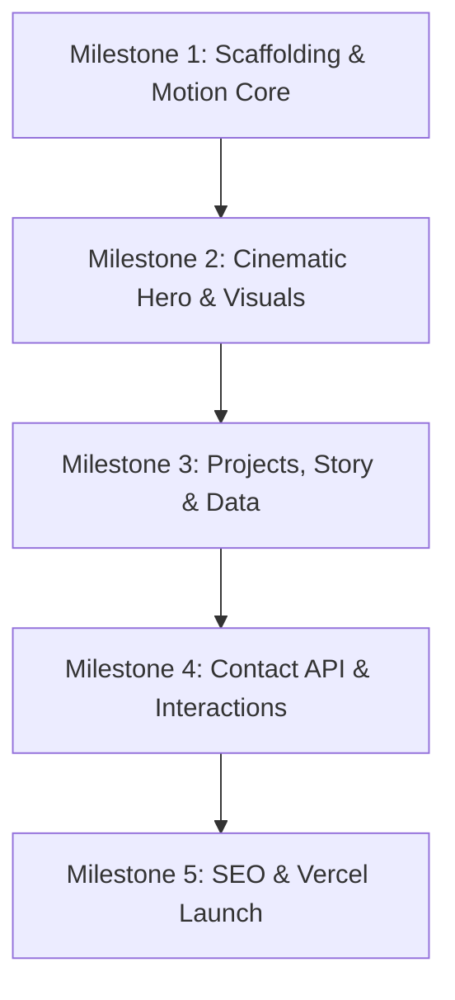
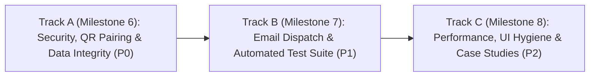
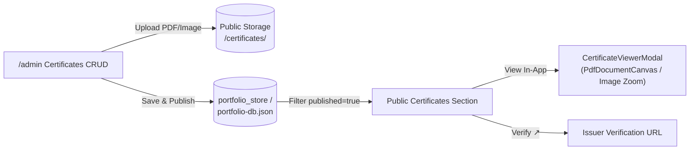
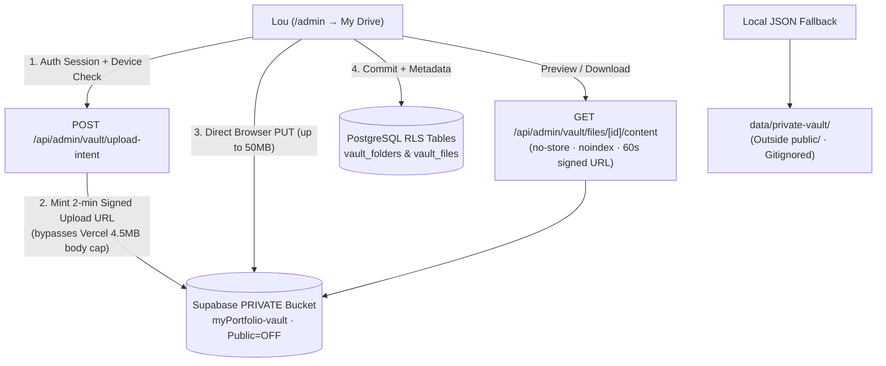

# Master Portfolio Roadmap & API Architecture
**Project:** Lou Diamond Lava Valdellon — Cinematic Full-Stack & Business Analytics Portfolio  
**Target Platform:** Vercel (Hobby Tier — $0/month guaranteed)

---

## 1. Do We Need an API? (The API Strategy)

For a portfolio, you want **maximum speed** (static generation) paired with **dynamic full-stack capabilities** (proving to recruiters that you understand APIs and backend engineering).

We will implement **two lightweight, serverless API routes** within Next.js:

```
┌─────────────────────────────────────────────────────────────┐
│                      Next.js Frontend                       │
│  (Hero, Projects, Liquid Cards, Kinetic Motion, UI Forms)   │
└──────────────┬──────────────────────────────┬───────────────┘
               │                              │
        POST /api/contact               GET /api/github
               ▼                              ▼
┌─────────────────────────────┐┌──────────────────────────────┐
│     Contact API Route       ││       GitHub API Route       │
│ - Zod request validation    ││ - Caches live GitHub metrics │
│ - Spam prevention (honeypot)││ - Fetches latest public work │
│ - Dispatches email straight ││ - Demonstrates real-world    │
│   to Lou's personal inbox   ││   API integration to tech    │
│   (Resend / Web3Forms)      ││   recruiters                 │
└─────────────────────────────┘└──────────────────────────────┘
```

### API 1: `/api/contact` (Interactive In-Site Messaging)
* **Problem it solves:** Many users dislike opening desktop mail clients like Outlook from `mailto:` links.
* **Function:** Accepts `name`, `email`, `subject`, and `message` from an on-page modal or footer form.
* **Security & Validation:**
  * Uses **Zod** schema validation to sanitize inputs.
  * Includes a hidden **honeypot field** to block automated spam bots without irritating CAPTCHAs.
* **Email Service:** Powered by **Resend** (free tier: 3,000 emails/mo) or **Web3Forms** (zero-config, free API key). Sends the message directly to `loudiamond.valdellon@gmail.com`.

#### API Contract (`POST /api/contact`):
```typescript
// Request Body
{
  "name": "Alex Mercer",
  "email": "alex@company.com",
  "subject": "Full-Stack Opportunity",
  "message": "Hi Lou, we loved your capstone project and want to schedule an interview."
}

// Response (200 OK)
{
  "success": true,
  "message": "Thank you, Lou has received your message and will reply shortly."
}
```

---

### API 2: `/api/github` (Live Engineering Proof — Optional)
* **Problem it solves:** Proves real-time code activity and technical capability directly on your site.
* **Function:** Queries GitHub REST API for your total repositories, star count, and top languages.
* **Performance:** Cached with Next.js ISR (Incremental Static Regeneration, revalidated every 1 hour) so it never hits GitHub's rate limits and loads instantly.

---

## 2. Project Data Models (Type-Safe Schemas)

All portfolio data is structured in TypeScript, making it easy to add projects, skills, or achievements without touching layout code:

```typescript
// src/types/portfolio.ts

export interface Project {
  id: string;
  title: string;
  category: "Full-Stack System" | "Business Analytics" | "Web Application";
  year: string;
  summary: string;
  role: string; // e.g. "Lead Developer: DB, API, Frontend"
  outcome: string; // e.g. "Production Capstone — Deployed"
  stack: string[]; // ["MySQL", "Node.js", "React", "Tailwind"]
  image: string; // Path to WebP mockup
  githubUrl?: string;
  liveUrl?: string;
  metrics?: string; // e.g. "Reduced query latency by 45%"
}

export interface SkillCategory {
  category: "Frontend" | "Backend" | "Database & Data" | "Analytics & Tools";
  skills: Array<{ name: string; level?: string; icon: string }>;
}
```

---

## 3. The 5-Milestone Implementation Roadmap



---

### Milestone 1: Scaffolding & Motion Infrastructure (Day 1)
- [ ] Initialize Next.js 15+ App Router with TypeScript and Tailwind CSS v4.
- [ ] Install core motion packages:
  ```bash
  npm install gsap @studio-freight/lenis split-type lucide-react clsx tailwind-merge zod
  ```
- [ ] Configure custom theme tokens in `globals.css`:
  * Obsidian dark theme (`#08080a`), surface colors, line dividers, signature accent red (`#ff3b1d`).
  * Load display font (**Anton**) and sans-serif font (**Onest** or **Geist**).
- [ ] Implement `SmoothScroll.tsx`:
  * Initialize **Lenis** smooth scroll and bind it to GSAP's `requestAnimationFrame` ticker.

---

### Milestone 2: Cinematic Intro & Hero Experience (Day 2)
- [ ] **`Preloader.tsx`**:
  * 0% $\rightarrow$ 100% tabular counter over 1.8 seconds.
  * Vertical curtain wipe animation unlocking Lenis scroll.
- [ ] **`Navbar.tsx`**:
  * Fixed glassmorphic navigation with monogram badge **`LV`** and magnetic links.
- [ ] **`Hero.tsx`**:
  * Kinetic letter-by-letter reveal for **LOU DIAMOND VALDELLON**.
  * Line-by-line staggered text for roles: *Full-Stack Developer*, *Analytics Engineer*, *Systems Builder*.
  * Composited portrait cutout with bottom obsidian gradient.
  * Animated scroll cue (`Scroll to Explore`).
- [ ] **`Marquee.tsx`**:
  * Infinite seamless marquee ticker (*Architect The Database • Build End-To-End • Data-Driven Thinking*).

---

### Milestone 3: Your Story, Projects & Systems (Day 3)
- [ ] **`Story.tsx`**:
  * Narrate your journey: stepping up as the sole developer for your group mates across frontend, backend, and database.
  * 4 Pillars grid with hover accent lines.
- [ ] **`LiquidImage.tsx`**:
  * Reusable SVG displacement filter component (`feTurbulence` + `feDisplacementMap`) that wobbles on hover.
- [ ] **`Projects.tsx`**:
  * Feature your Capstone System, Business Analytics Dashboard, and Full-Stack apps.
  * Offset 2-column staggered layout with liquid image cards.
- [ ] **`Impact.tsx`**:
  * Animated numeric counters (100% stack ownership, BSIT Class of 2026, 3+ systems built).
- [ ] **`Skills.tsx`**:
  * Visual badges organized by Database, Backend, Frontend, and Analytics.

---

### Milestone 4: Backend API & Contact Experience (Day 4)
- [ ] Create API Route `src/app/api/contact/route.ts`.
- [ ] Setup validation with Zod and integrate email dispatch (Resend or Web3Forms).
- [ ] Build **`Contact.tsx`**:
  * Magnetic `mailto:` anchor with expanding arrow indicator.
  * Interactive "Send a Message" form with loading, success, and error states.
  * Footer bar with copyright, social links (GitHub, LinkedIn), and status badge (*Available for Opportunities*).

---

### Milestone 5: Optimization, Polish & Vercel Deployment (Day 5)
- [ ] Run Lighthouse audit (target: 95+ score on Performance, Accessibility, Best Practices, SEO).
- [ ] Add `prefers-reduced-motion` fallbacks for accessibility.
- [ ] Generate Open Graph card (`/opengraph-image.png`) for social sharing.
- [ ] Initialize Git repo, push to GitHub, and connect to **Vercel**.
- [ ] Test live URL on mobile devices and desktops.

---

## 4. Free Hosting Guarantee & Maintenance Checklist

* **Hosting:** Vercel Hobby Tier gives you unlimited deployments, 100GB bandwidth, and zero server fees.
* **Database & Media Storage:** **Supabase (Free Tier)** provides a 500MB PostgreSQL database + 1GB File Storage for project mockups and avatars at **$0/month**.

---

## 5. Full-Stack Portfolio Management System (`/admin` CMS Plan)

To showcase your **Full-Stack Engineering (DB + API + UI)** and **BSIT Business Analytics** specialization, the portfolio includes a dedicated **Portfolio Management & Analytics System** at `/admin`.

```mermaid
flowchart LR
    Visitor["Public Visitor (/)"] -->|0ms Static Cache| Edge["Next.js Static / ISR Cache"]
    Visitor -->|POST /api/contact & Events| API["Next.js API Routes"]
    Admin["Lou (/admin Dashboard)"] -->|CRUD + Auth| API
    API -->|SQL Queries & Storage| DB[("PostgreSQL + Storage\n(Supabase Free Tier)")]
    API -->|revalidatePath('/')| Edge
```

### A. The 6 Core Admin Modules

1. **Module 1: Security & "Recruiter Demo Mode" (`/admin/login`)**
   * **Admin Authentication:** Protected login (Email/Password or GitHub OAuth via Supabase Auth / HTTP-only JWT session).
   * **Recruiter Read-Only Demo Mode *(Optional)*:** Allows technical recruiters to explore your `/admin` dashboard and analytics charts in a safe **Read-Only** mode (all Save/Delete buttons disabled) to prove your full-stack & analytics engineering skills!
2. **Module 2: Business Analytics & KPI Overview (`/admin`)**
   * **Executive KPI Cards:** Total Page Views, Project Demo Clicks, Resume Downloads, Unread Contact Inquiries.
   * **Visual Analytics:** Interactive charts showing visitor traffic trends, most clicked Projects, and Story Chapter engagement (`01 Story` $\rightarrow$ `05 Contact`).
3. **Module 3: Projects & Case Studies CRUD (`/admin/projects`)**
   * Create, edit, reorder, and delete projects.
   * Fields for Title, Category, Year, Role, Description, **The Problem**, **Engineered Solution**, **Impact Metrics**, Tech Stack tags, GitHub URL, and Live Demo URL.
   * **Drag-and-Drop Image Uploader** for project thumbnails (`LiquidImage`).
   * **Published / Draft Toggle** so you can prepare new projects privately before publishing.
4. **Module 4: Profile, Hero & Story Manager (`/admin/profile`)**
   * Update Hero Roles, Bio Pitch, Availability Badge (*Available for Roles* / *Employed*), and Resume PDF link.
   * Upload/swap Hero Cutout Avatar (`avatar.png`).
   * Edit Origin Story paragraphs, Marquee ticker statements, and the 4 Core Pillars.
5. **Module 5: 4-Layer Tech Bento & Impact Metrics (`/admin/skills`)**
   * Manage the 4 System Layers (*Database*, *Backend*, *Frontend*, *Business Analytics*).
   * Add/remove skills, reorder them, and toggle the accent **Highlight** badge.
   * Edit the 4 By-The-Numbers Impact stats (`100%`, `2026`, `3+`, `60-120 FPS`).
6. **Module 6: Contact Inbox & Lead Tracker (`/admin/inbox`)**
   * Stores all submissions from the public Contact Form in PostgreSQL.
   * Filter by `Unread`, `Read`, `Starred`, or `Archived`, with a 1-click **"Reply via Email"** action.

### B. Relational Database Schema (PostgreSQL)

| Table | Primary Columns | Purpose |
| :--- | :--- | :--- |
| `profile_settings` | `id`, `full_name`, `headline`, `bio`, `status`, `email`, `github`, `linkedin`, `avatar_url`, `resume_url`, `roles[]`, `story_heading`, `story_body[]`, `marquee_items[]` | Stores global identity, hero, and story copy. |
| `projects` | `id`, `title`, `category`, `year`, `role`, `description`, `problem`, `solution`, `metrics`, `stack[]`, `image_url`, `github_url`, `live_url`, `sort_order`, `is_published` | Stores featured systems & case studies. |
| `skill_categories` | `id`, `slug`, `eyebrow`, `title`, `description`, `sort_order` | The 4 Bento Grid system layers. |
| `skills` | `id`, `category_id` (FK), `name`, `level`, `highlight`, `sort_order` | Individual skills linked to each layer. |
| `story_pillars` | `id`, `number`, `title`, `description`, `sort_order` | The 4 core origin pillars. |
| `impact_metrics` | `id`, `value`, `prefix`, `suffix`, `label`, `description`, `sort_order` | The 4 big numeric counters. |
| `contact_messages` | `id`, `name`, `email`, `subject`, `message`, `is_read`, `is_starred`, `created_at` | In-site contact form inbox. |
| `analytics_events` | `id`, `event_type` (`page_view`, `project_click`, `cv_download`), `target`, `created_at` | Cookieless Business Analytics tracking. |

---

## 6. Post-Audit Hardening & Next Implementation Roadmap (Tracks A–C)

Following completion of the initial 5 milestones, `/admin` CMS workspace, Settings Hub, QR device pairing, PWA offline support, Appearance Studio, Global Search, and Analytics Overview, a full-app code and security audit identified remaining hardening, functional, performance, and hygiene tasks organized into three follow-up tracks:



---

### Track A (Milestone 6 — Priority 1): Security, QR Pairing & Data Integrity (`P0`)

* **QR Device Pairing State Machine (`src/app/api/admin/devices/pair/route.ts`, `pair/verify/route.ts`, `QrDevicePairModal.tsx`, `DevicePairClient.tsx`):**
  - [x] Fix reject/cancel polling 404 loop: in `PUT /api/admin/devices/pair/verify`, check terminal challenge statuses (`cancelled`, `burned`, `expired`) before rejecting missing `claimTokenHash`, so `DevicePairClient.tsx` exits polling cleanly when desktop rejects or cancels.
  - [x] Enforce `challenge.expiresAt` on `"approved"` challenges in `PUT /api/admin/devices/pair/verify`.
  - [x] Move pairing status, expiry, `attempts`, and `claimToken` checks inside `mutateAdminSecurityStore()` to eliminate read-then-write TOCTOU races.
  - [x] Restrict `resolveRequestOrigin()` in `src/app/api/admin/devices/pair/route.ts` to allowlisted canonical origins (plus explicit dev localhost/LAN targets) instead of trusting arbitrary `originOverride` or unvalidated `x-forwarded-host` / `x-forwarded-proto` headers.
  - [x] Polish `src/components/admin/settings/QrDevicePairModal.tsx` & `src/components/admin/DevicePairClient.tsx`: stop the `setInterval` countdown once expired/terminal, display `"Pairing Cancelled"` when cancelled, add a copyable 1-time Pairing Link + Challenge ID badge, and add manual link/ID lookup on `/admin/pair`.
* **Auth, Self-Lockout, Offline TOTP 2FA & Fail-Closed Storage (`src/lib/auth.ts`, `src/lib/security.ts`, `src/lib/totp.ts`, `src/lib/db.ts`, `src/app/api/admin/devices/route.ts`, `.gitignore`):**
  - [x] Fail closed on transient Supabase read errors in `readAdminSecurityStore()` and `readAdminCredentialOverride()` instead of silently falling back to defaults (`stealthGateEnabled: false` or env `ADMIN_PASSWORD`), and serialize `mutateAdminSecurityStore()` writes so concurrent updates cannot overwrite trusted devices or audit logs.
  - [x] Clear or re-issue `ADMIN_COOKIE_NAME` properly when revoking or deleting `ctx.currentDeviceId` in `PATCH /api/admin/devices` and `PATCH /api/admin/auth` so unregistering or removing the current device does not trigger immediate `401` self-lockout in `getSessionAndDeviceContext()`.
  - [x] Remove the `ADMIN_PASSWORD` fallback in `getSecret()` (`src/lib/auth.ts`) and require a dedicated `ADMIN_SESSION_SECRET`.
  - [x] Add zero-dependency RFC 6238 Authenticator App 2FA (`TOTP` with AES-256-GCM encryption at rest & replay protection) via `/api/admin/devices/totp`, `TotpSetupModal.tsx`, `SecurityAccessSettings.tsx`, and 2-step `AdminLogin.tsx`.
  - [x] Ignore `/data/portfolio-db.json` in `.gitignore` alongside existing `/data/admin-*.json` and `/data/portfolio-snapshots.json` stores.
* **Uploads, CSP, Validation, Rate Limits & Public Payload Filtering:**
  - [x] Harden `POST /api/admin/upload`: reject empty MIME types, verify file magic bytes (`src/lib/uploadSecurity.ts`), and block same-origin `.svg` / `image/svg+xml` uploads.
  - [x] Harden `isSafeUploadStoragePath()` in `src/lib/backups.ts` to reject `?`, `#`, `%` and apply `encodeURIComponent()` to object filenames before Supabase Storage deletes.
  - [x] Apply a global `Content-Security-Policy` header in `next.config.ts` across `/(.*)` (not only `/sw.js`) and replace wildcard `images.remotePatterns` (`hostname: "**"`) with explicit allowed hosts.
  - [x] Add Zod/domain validation for `sectionHeaders`, `marqueePrinciples`, `pillars`, `skills`, `projects`, and `impactMetrics` in `PUT /api/admin/portfolio`, plus `try/catch` guards on `GET /api/admin/portfolio` and `GET`/`DELETE /api/admin/devices/pair`.
  - [x] Update `"flush-server-cache"` in `POST /api/admin/system` to call `revalidateTag` / `revalidatePath("/", "layout")` alongside `clearPortfolioMemoryCache()`, matching the `MaintenanceDangerSettings.tsx` status message.
  - [x] Extend IP/key rate limiting beyond `POST /api/admin/auth` to `/api/contact`, `/api/analytics`, `/api/psgc` (with `AbortSignal.timeout`), `PUT /api/admin/auth`, `/api/admin/devices/pair/verify`, and `?portal=` stealth-key checks in `src/app/admin/page.tsx`.
  - [x] Filter out unpublished draft projects (`published === false`) and strip private PII fields (`profile.birthDate`, detailed `profile.contact.address` PSGC codes/barangay) from SSR `initialData` in `src/app/layout.tsx` and `GET /api/portfolio` via `src/lib/portfolioPublic.ts`.

---

### Track B (Milestone 7 — Priority 2): Email Dispatch, Relational Scale & Automated Tests (`P1`)

* **Real Email Dispatch & Inbox Reply Flow (`src/app/api/contact/route.ts`, `src/components/admin/InboxManager.tsx`):**
  - [x] Wire transactional email delivery (e.g., Resend or SMTP via Nodemailer) into `POST /api/contact` so visitor inquiries trigger real email notifications in addition to database storage.
  - [x] Remove the unreachable `honeypot` branch after `apiContactSchema.parse` and sanitize `StorageWriteError.message` on HTTP `503`.
  - [x] Add an optional server-dispatched **"Send Reply"** workflow in `InboxManager.tsx` alongside the existing `mailto:` quick-reply button.
* **Relational Supabase Migration (`supabase/schema.sql`, `src/lib/db.ts`):**
  - [x] Migrate high-churn `messages` and `analytics` arrays out of the single `portfolio_store` JSONB document into the normalized `contact_messages` and `analytics_events` tables so Vercel multi-instance deployments do not share stale in-memory caches or hit the `2,000`-event cap.
* **Automated Testing & Quality Gates (`package.json`):**
  - [x] Add Vitest unit/integration tests (`npm run test`) covering `src/lib/auth.ts`, `src/lib/security.ts` pairing flows, `src/lib/validation.ts`, and `src/lib/analytics.ts`.
  - [x] Add Playwright end-to-end smoke tests covering public portfolio navigation, contact submission/outbox sync, `/admin` login/stealth gate, and CMS publish/restore flows.

---

### Track C (Milestone 8 — Priority 3): Performance, UI/CSS Hygiene & Public Case Studies (`P2`)

* **CSS Tokens, Primitive Consistency & `/offline` UX:**
  - [x] Define `--shadow-card` in `src/app/globals.css` (referenced by `src/app/offline/page.tsx`, `OfflineBanner.tsx`, and `Footer.tsx`).
  - [x] Fix invalid `gap-inherit` utility inside `src/components/ui/Button.tsx` (`slideDirection` content wrapper).
  - [x] Refactor `src/app/offline/page.tsx` raw `<button>` and `<Link>` controls to use the reusable `<Button>` primitive; update `Navbar.tsx` on `/offline` so hash links navigate back to `/#story`..`/#contact` (or hide chapter tabs), and skip mounting `Preloader` on `/offline`.
* **Core Web Vitals, Motion & Media Hygiene:**
  - [x] Convert `public/assets/hero/avatar.png` (`~661 KB`) to compressed `.webp`/`.avif`.
  - [x] Review `DEFAULT_APPEARANCE.preloaderMode` (`"once-per-session"` default vs `"always"`), replace per-frame React `setCount` state updates in `Preloader.tsx` with direct ref/text updates, and wrap `Preloader.tsx` & `SplitText.tsx` GSAP animations in `gsap.context()`.
  - [x] Fix `LiquidImage.tsx` so SVG `<filter>` is only applied on desktop fine-pointer hover (`(hover: hover) and (pointer: fine)`), and reset `imageError` / `hasCustomImage` when `src` changes in both `LiquidImage.tsx` and `Avatar.tsx` (removing hardcoded fallback owner copy from `Avatar.tsx`).
  - [x] Fix `SplitText.tsx` (`type="lines"` implementation, include `text` and `type` in effect deps, avoid trailing `mr-[0.25em]` on last word), and optimize Google Font loading in `src/app/layout.tsx` so unused pairings do not ship unnecessary font files on initial visit.
* **Dynamic Metadata & Public Project Showcase Depth:**
  - [x] Sync `src/app/manifest.ts` metadata/theme colors and `src/app/layout.tsx` OpenGraph/Twitter descriptions and keywords dynamically from `getPortfolioContent()`.
  - [x] Surface CMS `featured` and `outcome` metadata on public `ProjectCard.tsx`, add public category/stack filtering in `Projects.tsx`, and build a dedicated `/projects/[id]` route or interactive case-study drawer (updating `src/app/sitemap.ts`).
* **Dead Code Cleanup:**
  - [x] Remove unused `recordAnalyticsEvent` export from `src/lib/db.ts` and archive/remove redundant early draft docs (`prompt.md`) once no longer needed.

---

### Track D (Milestone 9 — Priority 4): In-App Media Viewer, Device Pairing Polish, Curtain Preloader & System Documentation (`P1`)

* **Full-Viewport Curtain Preloader & BrandPortal Refinements:**
  - [x] Refactor `src/components/motion/Preloader.tsx` from an inline navbar strip into a cinematic, full-screen fixed curtain (`z-200`) with GPU-accelerated `scaleX` progress bar and curtain wipe exit.
  - [x] Streamline `BrandPortal.tsx` & `BrandPortalOrb.tsx` by removing the `window.scrollTo` top-of-page fallback so the stealth portal orb functions strictly as an administrative gateway without duplicate scroll actions.
* **Admin CMS Hygiene & Security Pagination:**
  - [x] Clean up `ProfileDropdown.tsx` by removing "Secret Logo Redirect" and "Reset Content to Seed Defaults" controls (consolidating security controls in the Security Access tab and factory resets in Maintenance & Danger Zone).
  - [x] Restrict container height in `SecurityAccessSettings.tsx` to 360px with custom `<ScrollArea>` and added 3-item incremental "Load more" device pagination.
  - [x] Clean up `InboxManager.tsx` to remove misleading sandbox badge text while preserving Resend diagnostics and manual test email triggers.
  - [x] Rebalance `QrDevicePairModal.tsx` into a clean 2-column layout (QR code & link on the left, 6-digit PIN and security permissions on the right) and eliminate all manual localhost/LAN IP origin overrides.
* **In-App Resume Viewer & SSRF-Protected Proxy:**
  - [x] Implement secure same-origin PDF proxy route `src/app/api/resume/route.ts` with strict hostname allowlisting (preventing private IP/loopback SSRF), PDF magic-byte validation (`%PDF-`), and inline/attachment stream headers.
  - [x] Create accessible `src/components/common/ResumeViewerModal.tsx` featuring fullscreen expansion toggle, A4 skeleton document loading state, and direct PDF download fallback.
  - [x] Update `Hero.tsx` CTA to prewarm PDF assets on hover/focus and open the resume directly inside the modal rather than redirecting to an external tab.
  - [x] Update `next.config.ts` Content Security Policy frame directives (`frame-src 'self' blob: https://drive.google.com`) and exempt `/api/resume` from default frame-blocking.
* **Tooltip Boundary Fix & Analytics Clarification:**
  - [x] Fix vertical layout crushing in `src/components/ui/Tooltip.tsx` by anchoring at `(0,0)`, enforcing `w-max`, and applying dynamic boundary-clamped positioning via `useLayoutEffect`.
  - [x] Document traffic telemetry attribution (separating unattributed "Legacy" fallback events from modern device split donuts, and clarifying Direct, Internal, and External referral sources).
* **Master System Architecture & Tools Documentation:**
  - [x] Generate comprehensive `SYSTEM_DOCUMENTATION.md` covering full tech stack, hybrid database sync, multi-layer admin security, telemetry engine, and deployment guide.

---

### Track E (Milestone 10 — Priority 5): Fluid `rem` Responsiveness, Master–Detail Spotlight & Seamless `<Tabs />` (`P1`)

* **Fluid `rem` Typography, `--gutter` & Uniform Grid Alignment:**
  - [x] Standardize `--gutter: clamp(1rem, 4vw, 2.5rem)` and `--section-py: clamp(3rem, 7vw, 7.5rem)` across all public sections (`Hero`, `Story`, `TechBento`, `Projects`, `Impact`, `Contact`, `Footer`, `Navbar`).
  - [x] Convert hardcoded `px` font sizes in `Typography.tsx`, `StatusPill.tsx`, `BadgeCounter.tsx`, `Button.tsx`, and `Tabs.tsx` to fluid `rem`/`clamp()` scales while preserving `1px` crisp borders.
  - [x] Align skill badges in `BentoCard.tsx` (`grid-cols-2 sm:grid-cols-3`) and tech stack tags in `ProjectCard.tsx` (`grid-cols-3 sm:grid-cols-6`) into equal-width CSS Grid cells.
* **Seamless Horizontally Scrollable `<Tabs />`:**
  - [x] Hide native horizontal scrollbars via `.no-scrollbar`, fix flexbox overflow clipping (`shrink-0 min-w-full w-max`), and add pointer drag-to-scroll (`onPointerDown`/`onPointerMove`), `data-lenis-prevent` wheel scrolling, and automatic active-tab centering.
* **Master–Detail Spotlight Projects & Responsive Tech Bento:**
  - [x] Upgrade `Projects.tsx` to a clean **Master–Detail Spotlight Switcher** (5-column interactive System Directory on desktop + 7-column stacked GPU crossfade Spotlight Stage, and horizontally scrollable `<Tabs />` + compact viewport-fitted card on mobile) with a spring-gliding `[ Spotlight | Grid ]` mode toggle synced with `/admin` Appearance Studio.
  - [x] Upgrade `TechBento.tsx` to render a balanced **2×2 Bento Matrix** on desktop (`>= 768px`) and a horizontally scrollable `<Tabs />` + stacked GPU crossfade single card on mobile (`< 768px`).
  - [x] Implement smart presence-aware auto-advance (`9s` interaction cooldown + pointer/focus pause) so cards never auto-advance while the user is reading or interacting.

---

### Track F (Milestone 11 — Priority 6): Public Certificates & Credentials Showcase (`P1`)

Adds a dedicated verifiable **Certificates & Credentials** feature across both the public portfolio and `/admin` CMS so recruiters can inspect certifications, honors, and seminar credentials in-app without leaving the page.



* **Data Model, Validation & Hybrid Storage (`src/types/portfolio.ts`, `src/data/certificates.ts`, `src/lib/validation.ts`, `src/lib/db.ts`, `src/lib/portfolioPublic.ts`, `src/lib/backups.ts`):**
  - [ ] Define `Certificate` schema (`id`, `title`, `issuer`, `category`, `issuedDate`, `expiryDate?`, `credentialId?`, `credentialUrl?`, `fileUrl?`, `fileType?: "image" | "pdf"`, `thumbnailUrl?`, `thumbnailTransform?`, `skills[]`, `summary?`, `featured`, `published?`) and add `certificates: Certificate[]` to `PortfolioDatabase`.
  - [ ] Extend `SectionHeaders` with `certificatesEyebrow`, `certificatesHeading`, and `certificatesSubtitle`, and extend `AnalyticsEvent.type` with `"certificate_view"`.
  - [ ] Add `"certificates"` to `UPLOAD_SUBFOLDERS` (`src/lib/backups.ts`) and allow verified raster images + PDFs (`%PDF-` magic-byte check) for `folder === "certificates"` in `POST /api/admin/upload`.
  - [ ] Register certificate asset URLs in `extractReferencedAssetPaths()` (protecting active certificates from orphan cleanup), strip draft certificates (`published === false`) in `src/lib/portfolioPublic.ts`, and include `certificates` in Backup/Snapshot export & selective restore.
* **Public Portfolio Showcase & In-App Viewer (`src/components/sections/Certificates.tsx`, `src/components/common/CertificateViewerModal.tsx`, `src/app/api/certificates/[id]/file/route.ts`):**
  - [ ] Build `Certificates.tsx` chapter partial with category filter tabs (reusing `<Tabs />`), featured credential badges, issuer & date metadata, skill chips, external `Verify ↗` link, and an in-app `View Certificate` trigger (auto-hides cleanly when zero published certificates exist).
  - [ ] Build `CertificateViewerModal.tsx` reusing the multi-page `PdfDocumentCanvas` for PDF certificates and a crisp zoomable image frame for image certificates, plus same-origin SSRF-guarded `/api/certificates/[id]/file` streaming proxy.
  - [ ] Wire section into `src/app/page.tsx`, `Navbar.tsx` chapter links/scroll observer, and `AnalyticsOverview.tsx` telemetry feed.
* **Admin CMS Manager (`src/components/admin/CertificatesManager.tsx`, `src/components/admin/CertificateCardEditor.tsx`, `src/components/admin/layout/types.ts`, `globalSearchIndex.ts`):**
  - [ ] Add a dedicated `certificates` tab in `/admin` with Create/Edit/Delete, pointer drag-to-reorder (`usePointerReorder`), Featured & Published/Draft toggles, certificate PDF/image uploader, issuer verification URL validation, and Global Search indexing.
* **Verification:**
  - [ ] Add Vitest unit tests covering certificate Zod validation, public draft redaction, orphan media reference protection, and `/api/certificates/[id]/file` proxy security.

---

### Track G (Milestone 12 — Priority 7): Private Personal Document Vault — "My Drive" (`P1`)

Adds an **owner-only, Google-Drive-style Personal Document Storage Vault** inside `/admin` for soft-copy personal documents (government IDs, transcripts/TOR, diploma, clearances, contracts, medical/financial records) with strict zero-public-exposure isolation and $0/month Vercel + Supabase Free Tier compatibility.



* **Zero-Public-Exposure Security & Storage Isolation (`supabase/schema.sql`, `src/lib/vaultDb.ts`, `src/lib/vaultStorage.ts`, `.gitignore`):**
  - [ ] Provision isolated PostgreSQL tables (`public.vault_folders`, `public.vault_files`) with **Row Level Security enabled** (Service Role only) and a local fallback index at `data/private-vault-index.json` + binary store at `data/private-vault/` (strictly outside `public/` and ignored in `.gitignore`).
  - [ ] Store cloud binaries in a dedicated **private** Supabase Storage bucket (`SUPABASE_VAULT_BUCKET`, default `myPortfolio-vault`, `Public = OFF`), completely decoupled from the public `myPortfolio` bucket, public `/api/portfolio` DTO, `sitemap.xml`, and public orphan media scanner.
  - [ ] Enforce strict admin authentication (`getSessionAndDeviceContext()` + active session epoch) on every `/api/admin/vault/**` endpoint, emit `Cache-Control: private, no-store`, `X-Robots-Tag: noindex, nofollow`, and log every upload/view/download/delete to the `admin-security` audit trail.
  - [ ] Add optional **Vault Idle Lock** (re-verify via Passkey, TOTP 2FA, or Admin Password after configurable idle timeout for sensitive folders).
* **Vercel-Safe Large File Upload & Streaming APIs (`src/app/api/admin/vault/**`):**
  - [ ] `GET/POST /api/admin/vault/folders` & `PATCH/DELETE /api/admin/vault/folders/[id]` — Nested folder CRUD, pin/color, and safe move/delete.
  - [ ] `GET /api/admin/vault/files` — Paginated listing with folder scope, `starred`, `recent`, `trash`, file-type filter, search query, sort order, and total storage quota stats (against the 1 GB Supabase Free Tier).
  - [ ] `POST /api/admin/vault/upload-intent` + `POST /api/admin/vault/files/commit` — Presigned direct-to-private-bucket upload flow (supports files up to 50 MB without hitting Vercel's 4.5 MB serverless body limit; local mode streams to `data/private-vault/`), enforcing a strict soft-copy allowlist (`.pdf`, `.png`, `.jpg`, `.webp`, `.avif`, `.doc`, `.docx`, `.xls`, `.xlsx`, `.ppt`, `.pptx`, `.txt`, `.md`, `.csv`, `.zip`) and blocking active executable/XSS formats (`.svg`, `.html`, `.js`, `.exe`, `.sh`).
  - [ ] `GET /api/admin/vault/files/[id]/content` & `PATCH/DELETE /api/admin/vault/files/[id]` — Authenticated inline preview / attachment download (short-lived 60s signed URL or proxied byte-range stream), rename, move folder, edit tags/notes, star, soft-delete to Trash, restore, and permanent purge (removing both DB row and storage blob).
  - [ ] Optional explicit **"Copy to Public Certificates"** action (`POST /api/admin/vault/files/[id]/promote-certificate`) to duplicate a selected certificate soft copy from Private Vault into a new public Certificates draft without ever exposing the vault original.
* **Google-Drive-Style Modular Admin UI (`src/components/admin/VaultManager.tsx`, `src/components/admin/vault/*`):**
  - [ ] `VaultSidebar.tsx`: Quick views (`My Drive`, `Starred`, `Recent`, `Trash`), collapsible folder tree (with starter folder templates: *Government IDs*, *Academic & Transcripts*, *Certificates & Licenses*, *Employment & Contracts*, *Personal & Medical*), and live **Storage Quota Meter**.
  - [ ] `VaultToolbar.tsx` & `VaultDropzone.tsx`: Breadcrumb trail, instant search across filename/tags/notes, file-type chips, `[ Grid | List ]` toggle, drag-and-drop multi-file uploader with per-file progress bars.
  - [ ] `VaultFileBrowser.tsx`: Responsive grid cards and detail table with multi-select batch actions (Move, Star, Trash, Restore, Permanent Delete).
  - [ ] `VaultPreviewModal.tsx`: Universal in-app viewer reusing `PdfDocumentCanvas` for multi-page PDFs, zoomable image viewer for scanned IDs/photos, clean monospace viewer for text/CSV/Markdown, and rich metadata + 1-click download card for Office/ZIP archives.
* **Verification:**
  - [ ] Add Vitest unit & security tests verifying unauthenticated `401` rejection on all vault routes, path-traversal/MIME blocking, soft-delete & permanent purge cleanup, signed upload intent validation, and zero vault leakage in public `/api/portfolio` DTOs.


